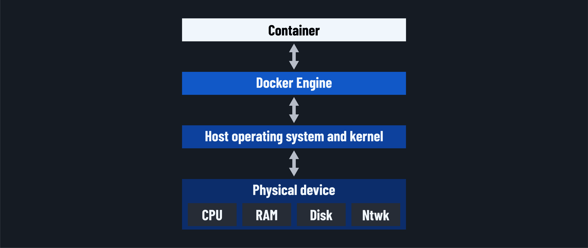
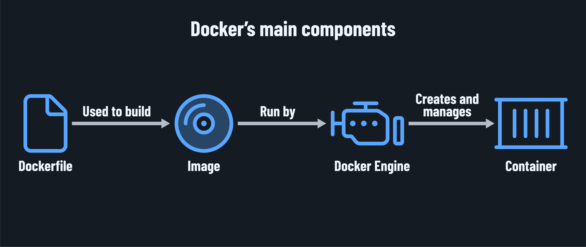

<h1>
  <span class="headline">Intro to Docker</span>
  <span class="subhead">How Containers Work</span>
</h1>

**Learning objective:** By the end of this lesson, students will be able to describe how Docker containers use system resources like memory, CPU, and network in a secure, isolated environment and explain the relationship between Docker images and containers.

## How containers work

Every operating system has a kernel - a central process that controls access to resources and manages requests from programs like Chrome or Terminal.

When an app, like Chrome, needs data from the hard drive, the OS processes the request. The OS will send a system call to the kernel if the request is valid. The kernel then directs the request to the appropriate place based on the app's needs and permissions.

This same idea is what a container is based on and how containers avoid needing a full guest OS with a kernel like a VM would. Our containers remain isolated because *namespaces* allow for computing resources to be isolated to a single process.



> 🧠 Since only Linux uses a kernel with namespacing, Docker installs a Linux virtual machine on Windows and macOS. When Docker runs, it creates containers inside this Linux VM, allowing the Linux kernel to manage resources and isolation.
>
> With Docker installed, running `docker version` in the terminal will reveal the OS as Linux in the output:
>
> ```plaintext
> $ docker version
> Client: Docker Engine - Community
>  Cloud integration: 1.0.12
>  Version:           20.10.5
>  API version:       1.41
>  Go version:        go1.13.15
>  Git commit:        55c4c88
>  Built:             Tue Mar  2 20:13:00 2021
>  OS/Arch:           darwin/amd64
>  Context:           default
>  Experimental:      true
> 
> Server: Docker Engine - Community
>  Engine:
>   Version:          20.10.5
>   API version:      1.41 (minimum version 1.12)
>   Go version:       go1.13.15
>   Git commit:       363e9a8
>   Built:            Tue Mar  2 20:15:47 2021
>   OS/Arch:          linux/amd64
>   Experimental:     true
>  containerd:
>   Version:          1.4.4
>   GitCommit:        05f951a3781f4f2c1911b05e61c160e9c30eaa8e
>  runc:
>   Version:          1.0.0-rc93
>   GitCommit:        12644e614e25b05da6fd08a38ffa0cfe1903fdec
>  docker-init:
>   Version:          0.19.0
>   GitCommit:        de40ad0
> ```

### How is an image related to a container?

A Docker image is like a ready-to-go package that includes everything an app needs to run - files, settings, and a startup command. Think of it as a snapshot in time of the app's setup. For instance, an image for Chrome would include all of Chrome's files, the command to launch it, and a stripped-down OS with only the things Chrome needs to run.

When you start a container from an image, this package gets loaded into its own secure, isolated space on the computer, accessible only to that container. The container then runs the app using only the specific resources assigned to it.

## From Dockerfile to image to container



The development process of creating a container involves a few steps.

Let's pretend we have a Dockerfile for an application called `my-app`. A developer might take the below steps to build an image and run a container from this file.

### 1. Dockerfile

The text file acts as a blueprint for setting up an environment. It lists everything the app needs, like files, packages, and configurations. When Docker reads the Dockerfile, it follows these instructions to set up the app's environment layer by layer.

In a CLI, when we're in the same directory as a completed Dockerfile, the below command could be used to build an image for the `my-app` application:

```bash
docker build -t my-app 
```

Once this command runs, Docker compiles everything specified in the Dockerfile into a Docker image by the same name: `my-app`.

### 2. Image

The image includes the app code, dependencies, and system settings. Think of the image as a read-only template the container will use when it's ready to run.

This command would run the `my-app` image, giving the developer access to the app at port 3000 on their machine:

```bash
docker run -p 3000:3000 my-app
```

### 3. Container

When Docker starts an image, it becomes a container. The container is a running instance of the image, isolated in its own environment with access to only the specific resources it needs. This isolation allows you to run the app consistently, regardless of the host machine's configuration.
