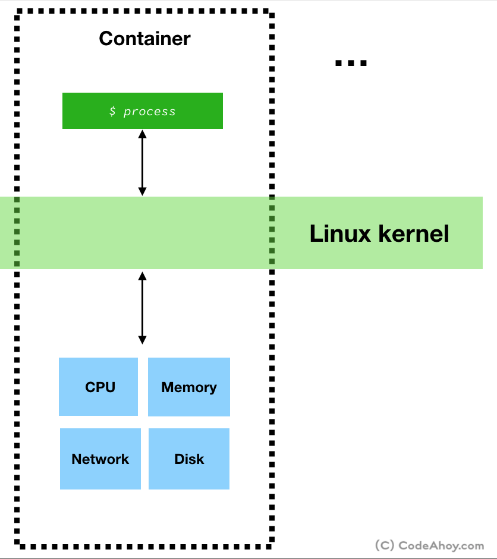
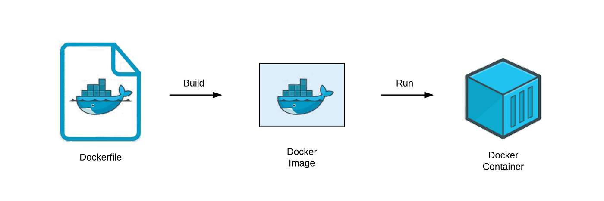

<h1>
  <span class="headline">Intro to Docker</span>
  <span class="subhead">How Containers Work</span>
</h1>

**Learning objective:** By the end of this lesson, students will be able to describe how Docker containers use system resources like memory, CPU, and network in a secure, isolated environment, and explain the relationship between Docker images and containers.

## How Containers Work

In every operating system, there’s a kernel—a central process that controls access to resources and manages requests from programs like Chrome or Terminal. When an app, like Chrome, needs data from the hard drive, it sends a system call to the kernel. The kernel then directs the request to the appropriate place based on the app's needs and permissions. This organization of resources by app is called **namespacing**.



[Source](https://codeahoy.com/img/dockercontainers/containers-on-box.png)

This is what a container is based on. A container is not a physical construct that exists inside your computer. Instead it is a process or set of processes that have a grouping of resources specifically assigned to it. Resources like memory, RAM, CPU, network.

### How is an Image Related to a Container?

A Docker **image** is like a ready-to-go package that includes everything an app needs to run—files, settings, and a startup command. Think of it as a "snapshot" of the app’s setup. For instance, an image for Chrome would include all of Chrome’s files plus a command to launch it.

When you start a container from an image, this package gets loaded into its own secure, isolated space on the computer, accessible only to that container. The container then runs the app (like Chrome) using only the specific resources assigned to it.

**Interesting Note:** Since only Linux uses a kernel with namespacing, Docker installs a Linux virtual machine (VM) on Windows and macOS. When Docker runs, it creates containers inside this Linux VM, allowing the Linux kernel to manage resources and isolation.

If you run `docker version` in your terminal, you'll see the OS as Linux in the output:

```
$ docker version
Client: Docker Engine - Community
 Cloud integration: 1.0.12
 Version:           20.10.5
 API version:       1.41
 Go version:        go1.13.15
 Git commit:        55c4c88
 Built:             Tue Mar  2 20:13:00 2021
 OS/Arch:           darwin/amd64
 Context:           default
 Experimental:      true

Server: Docker Engine - Community
 Engine:
  Version:          20.10.5
  API version:      1.41 (minimum version 1.12)
  Go version:       go1.13.15
  Git commit:       363e9a8
  Built:            Tue Mar  2 20:15:47 2021
  OS/Arch:          linux/amd64
  Experimental:     true
 containerd:
  Version:          1.4.4
  GitCommit:        05f951a3781f4f2c1911b05e61c160e9c30eaa8e
 runc:
  Version:          1.0.0-rc93
  GitCommit:        12644e614e25b05da6fd08a38ffa0cfe1903fdec
 docker-init:
  Version:          0.19.0
  GitCommit:        de40ad0
```

## From Dockerfile to Image to Container



<br>

Creating a container involves a few steps, starting with a Dockerfile:

### 1. **Dockerfile**

This text file acts as a blueprint for setting up an environment. It lists everything the app needs, like files, packages, and configurations. When Docker reads the Dockerfile, it follows these instructions to set up the app’s environment layer by layer.

```bash
docker build -t my-app          **** Example only ****
```

Once this command runs, Docker compiles everything specified in the Dockerfile into a Docker image by the same name.

### 2. **Image**

Based on the Dockerfile, Docker creates an image—a packaged snapshot of everything needed to run the app. The image includes the app code, dependencies, and system settings. Think of the image as a read-only template that the container will use when it’s ready to run.

```bash
docker run -p 3000:3000 my-app          **** Example only ****
```

Now, the container is running, and you can access the app at `localhost:3000`.

### 3. **Container**

When Docker starts an image, it becomes a container. The container is a running instance of the image, isolated in its own environment with access to only the specific resources it needs. This isolation allows you to run the app consistently, regardless of the host machine’s configuration.
