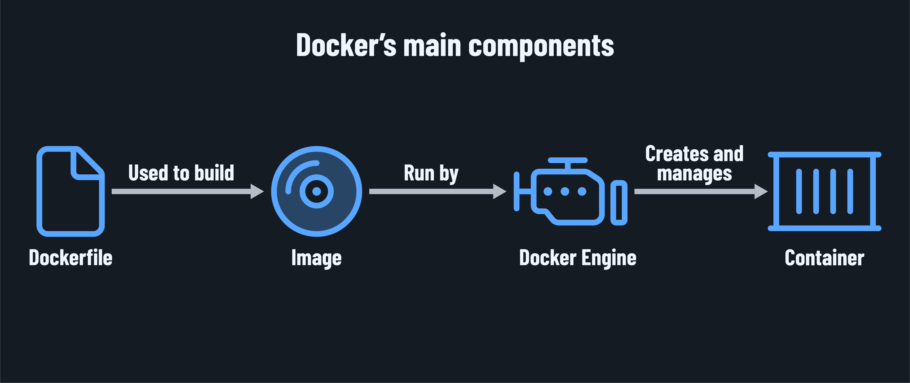

<h1>
  Intro to Docker
  The Main Components of Docker
</h1>

**Learning objective:** By the end of this lesson, students will be able to describe the key components of Docker (Dockerfile, image, container, Docker Engine) and explain how these components interact to create, manage, and run containers.

## How Docker works

Docker is the most popular open-source platform for building applications with containers. While it introduces new features, many of its components and principles existed before. Written in the [Go](https://docs.docker.com/engine/docker-overview/#the-underlying-technology) programming language , Docker leverages Linux kernel features like [namespaces](https://en.wikipedia.org/wiki/Linux_namespaces) and [cgroups](https://en.wikipedia.org/wiki/Cgroups) to create uniform, isolated environments.

The main goal of Docker is to **replicate the development environment in production**, benefiting both back-end and front-end applications. While running Docker locally is useful, its true advantages emerge when deploying on production machines.

## The main components of Docker

Docker works by providing a way to create and manage containers. Here are the main components of Docker:

| Term              | Description                                                                                               |
| ----------------- | --------------------------------------------------------------------------------------------------------- |
| **Dockerfile**    | A text file with instructions for building a Docker image. It specifies what goes into a container.         |
| **Image**         | A snapshot that serves as a blueprint for a container. It contains the necessary files and configurations. |
| **Container**     | A running isolated instance created from an image. It executes the application.     |
| **Docker Engine** | The core component that creates and runs containers. It directly integrates with the operating system.      |

### Let's take a closer look

- **Dockerfile**: A text file that tells Docker what resources should be used to build an image. It also details how those resources will be used. It includes these details:

  - The base image. This is typically a minimal operating system that only includes the necessary components to run software written in a specific language. This can be custom-created or sourced from a registry like [Docker Hub](https://hub.docker.com/search?badges=official).
  - The files that should be included in the image - for example, an executable file or script.
  - Any configuration, such as actions for the image to take when it starts up (like running an executable file or script).

- **Image**: A stand-alone blueprint for creating a container. It is created by Docker using the Dockerfile. It contains every component required to run an application, including:

  - A minimal OS.
  - A file system.
  - The libraries and frameworks necessary to execute the application.
  - Environment variables.
  - The application itself.

- **Container**: The running instance of an image. Containers are isolated from one another and the host OS. Containers can be created and destroyed at will, similar to starting and closing an application.

- **Docker Client (CLI)**: Used to communicate with the Docker Engine using the command line.

- **Docker Desktop (GUI and CLI)**: Used to communicate with the Docker Engine primarily using a GUI (although it also includes the Docker Client). This macOS and Windows app provides a user-friendly environment for managing images, containers, and storage.

- **Docker Engine**: The actual software that creates and runs containers. It integrates with the host OS's features, such as networking and storage, to ensure Docker containers run efficiently.

  - **Docker Daemon**: The core component of the Docker Engine. It listens for API requests from Docker Client and Docker Desktop. The Docker Daemon also manages Docker objects like images and containers.

  <h2 class="title">Docker Concepts: Research and Relate</h2>
  15 min

Understanding complex concepts can be easier when we relate them to familiar ideas. In this activity, you'll work in groups of 4. Each group member will research a specific Docker component and then create an analogy to explain that concept to a non-technical friend.

1. **Choose a Topic**: Each person in your group will select one of the following topics to research:

   - Docker image
   - Container
   - Dockerfile
   - Docker Hub

2. **Research (5 min)**: Spend a few minutes researching your assigned topic to solidify your understanding.

3. **Create an Analogy (5 min)**: Think of a relatable analogy that captures the essence of your topic. Consider how you might explain this concept to a non-technical friend.

4. **Group Sharing (5 min)**: Regroup with your team and take turns explaining your analogies to each other.
