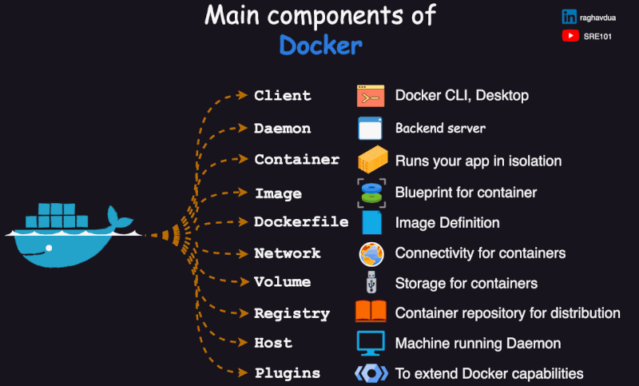

<h1>
  Intro to Docker
  The Main Components of Docker
</h1>

**Learning objective:** By the end of this lesson, students will be able to describe the key components of Docker (Dockerfile, image, container, Docker Engine) and explain how these components interact to create, manage, and run containers.

## How Docker Works

Docker is the most popular open-source platform for building applications with containers. While it introduces new features, many of its components and principles existed before. Written in the programming language [Go](https://go.dev/), Docker leverages Linux kernel features like [namespaces](https://en.wikipedia.org/wiki/Linux_namespaces) and [cgroups](https://en.wikipedia.org/wiki/Cgroups) to create uniform isolated environments.

The main goal of Docker is to **_replicate the development environment in production_**, benefiting both back-end and front-end applications. While running Docker locally is useful, its true advantages emerge when deploying on production machines.

## The Main Components of Docker

Docker works by providing a way to create and manage containers. Here are the main components of Docker:

| Term              | Description                                                                                               |
| ----------------- | --------------------------------------------------------------------------------------------------------- |
| **Dockerfile**    | A text file with instructions for building a Docker image, specifying what goes into a container.         |
| **Image**         | A snapshot that serves as a blueprint for a container, containing the necessary files and configurations. |
| **Container**     | An isolated, running instance created from an image, executing the application with its dependencies.     |
| **Docker Engine** | The core component that creates and runs containers, directly integrating with the operating system.      |

 

[source](https://www.linkedin.com/posts/raghavdua_docker-key-components-explained-understanding-activity-7229783032818188288--3Bs?utm_source=share&utm_medium=member_desktop)

## At a High Level

`Dockerfile --> Image --> Container --> Docker Engine --> ✨`

### Let's Take a Closer Look

- **Dockerfile**: Instructions for building an image.

  - Specifies the operating system, programming languages, and configurations.
  - Outlines actions for the container upon execution.
  - Can be custom-created or sourced from a registry.

- **Image**: The blueprint for creating a container.

  - Contains a portable file system with necessary files for the OS, frameworks, and the application.
  - Defines how components interact and operate.
  - Shares layers among containers for efficiency.

- **Container**: The running instance of an image, isolated and executing the app on the host OS.

- **Docker Engine**: Integrates with the OS to manage and run Docker containers efficiently.

  - **Docker Daemon**: Listens for API requests and manages Docker objects like images and containers. It performs the core functions of the Docker engine.
  - **Docker Client (CLI)**: Interacts with the Docker daemon via commands and scripts.

- **Docker Desktop**: A native application for MacOS and Windows that provides a user-friendly environment for building, shipping, and running Docker applications.

 <h2 class="title">Docker Concepts: Research and Relate</h2> 15 min 

_Breakout rooms: groups of 4_

Understanding complex concepts can be easier when we relate them to familiar ideas. In this activity, each group member will research a specific Docker component, then create an analogy to explain that concept to a non-technical friend.

1. **Choose a Topic**: Each person in your group will select one of the following topics to research:

   - Docker image
   - Container
   - Dockerfile
   - Docker Hub

2. **Research (5 min)**: Spend a few minutes researching your assigned topic to solidify your understanding.

3. **Create an Analogy (5 min)**: Think of a relatable analogy that captures the essence of your topic. Consider how you might explain this concept to a non-technical friend.

4. **Group Sharing (5 min)**: Regroup with your team and take turns explaining your analogies to each other.
