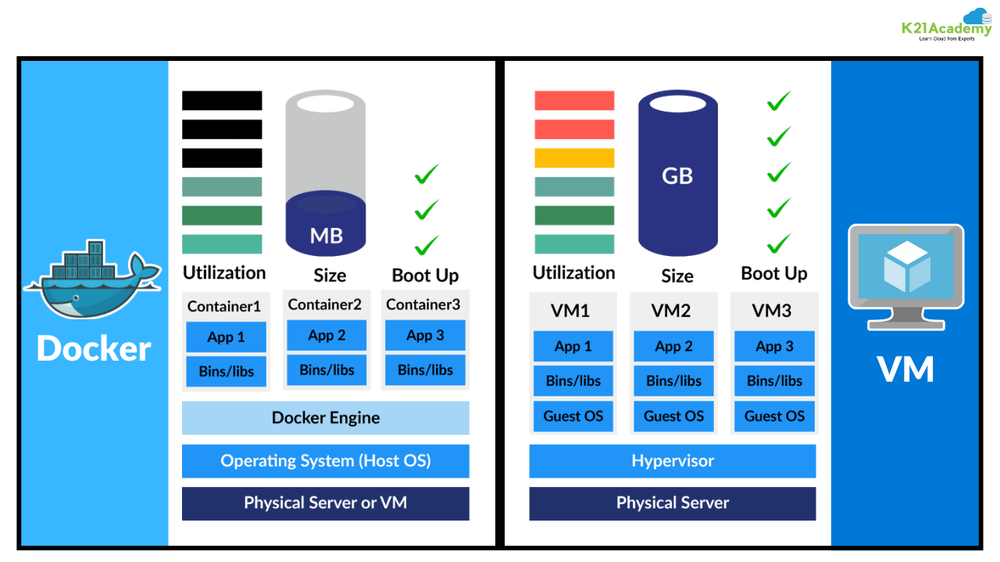

<h1>
  Intro to Docker
  What is Docker?
</h1>

**Learning objective:** By the end of this lesson, students will be able to explain Docker's purpose and identify the benefits of containerization over traditional virtual machines.

## What is Docker?

Docker is a platform designed to make it easier to create, deploy, and run applications by using **containers**. It allows developers to package an application with all of its dependencies into a standardized unit for software development.

## The Problems Docker Solves

Let's review some history, shall we?

Back in the early days of [Web 2.0](https://en.wikipedia.org/wiki/Web_2.0) (think early 2000s), building and deploying apps was like living in two completely different worlds. Developers would create apps on their own computers, but deploying them meant using totally different machines—ones that needed to be carefully set up, or "provisioned," with the right hardware and software. And it wasn’t quick! Getting those deployment machines ready could take days, even weeks.

More often than not, an app that was built on a developer's machine did not work properly in production. It was a frustrating game of ["but it works on my machine!"](https://static.packt-cdn.com/products/9781787286986/graphics/B06455_07_01.jpg)

## A Modern Solution: Virtual Machines

Things started to improve with the introduction of **virtual machines** (VMs).

A VM is essentially a simulated computer system that mimics the functions of a physical machine. By running multiple VMs on the same hardware, developers could separate different applications and reduce conflicts between them. This was a huge step forward because it helped prevent the "it works on my machine!" issues caused by differing environments.

However, VMs were far from perfect. Each VM required its own full operating system, making them heavy on storage, tough to maintain, and resource-hungry.

## A _Better_ Modern Solution: Containers

While VMs helped, developers kept looking for a leaner, more efficient solution.

Enter **_containers_**.

> A _container_ is a lightweight, standalone, executable package of software that includes everything needed to run an application: code, runtime, system tools, libraries, and settings.

Containers took the idea of isolation to the next level. Unlike VMs, containers share the same operating system **_kernel_** but still keep application environments separate. This made them much lighter and faster to start up. They also use fewer resources, allowing many more containers to run on the same hardware, making scaling up and down much easier.

> A _kernel_ is the core of an operating system that manages communication between the hardware and software, ensuring efficient use of system resources.

## Under the Hood: VMs vs Containers

The illustration below compares the infrastructure of Containers (left) with that of VMs (right).

- Containers share the host system’s kernel, which makes them lightweight, fast, and portable.
- Each VM contains a full operating system and emulates hardware. This makes VMs resource-heavy and slower to boot up.

 

[source](https://k21academy.com/docker-kubernetes/docker-vs-virtual-machine/)

 

Containers are an efficient, granular tool for combining software into enterprise-level applications and services.

Docker is a tool that _packages applications into containers_, including all dependencies, to ensure they run consistently across different environments.
