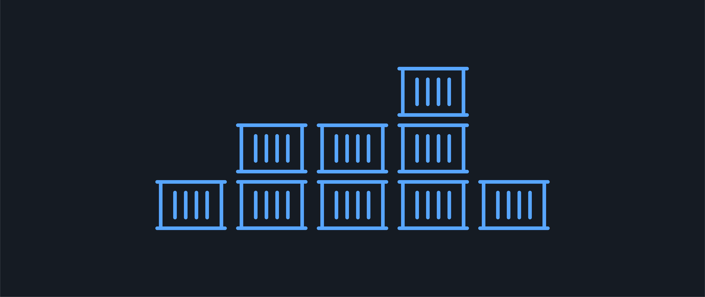
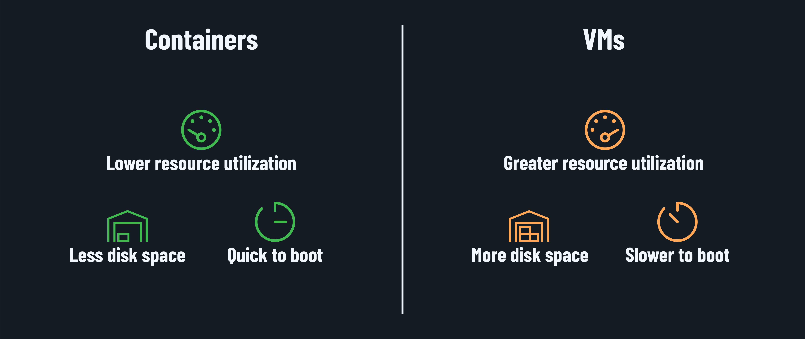
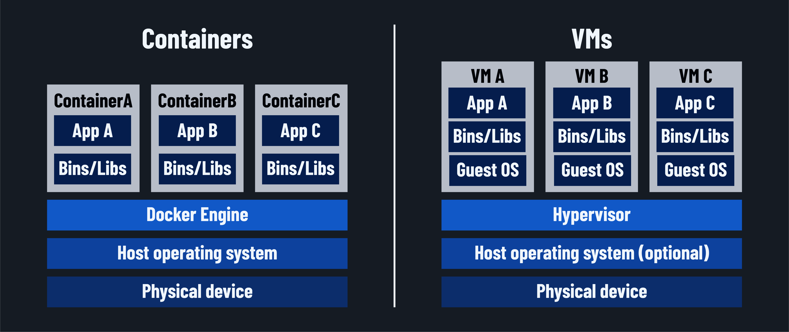

<h1>
  Intro to Docker
  What is Docker?
</h1>

**Learning objective:** By the end of this lesson, students will be able to explain the purpose of Docker software and identify the benefits of containerization over traditional virtual machines.

## What is Docker?

<!-- Don't get sued. Docker has very strict trademark guidelines available here: https://www.docker.com/legal/trademark-guidelines/. These guidelines ban the use of Docker's logo or imitations of their logo, even in educational material. -->

Docker is a platform designed to make creating, deploying, and running applications easier by using *containers*. Docker containers hold an application and its configurations and dependencies, all the way to the operating system level, in a single package.

Developers can build an application inside a container when starting a new project or migrate legacy apps that haven't yet been containerized into containers. Those containers can then be deployed into a production environment with relatively little configuration.

> 📚 A *container* is a lightweight, portable, and isolated unit of software that packages an application with its dependencies, tooling, libraries, and configuration, allowing it to run consistently across different environments.

## The problems Docker solves

For the most part, developers have always created apps on their own machines and then needed to deploy them to server machines so users can access them. How this has been accomplished has evolved through time, ultimately leading to the creation of Docker.

Let's review some history, shall we?

In the early 2000s, when [Web 2.0](https://en.wikipedia.org/wiki/Web_2.0) apps were gaining traction, building and deploying apps was like living in two completely different worlds. Like most modern development, developers would start by creating an app on their own machine.

That's where the similarities ended, though. Production machines had to be carefully set up, or *provisioned*, with the proper hardware and software. This wasn't quick - getting a production computer ready could take days or weeks in extreme cases.

An app built on a developer's machine frequently did not work correctly in production. Minor configuration differences between a development device and a production server could cause apps to crash (or, even worse, intermittently behave erratically). It was a frustrating game of "but it works on my machine!"

> 📚 *Provisioning* is the process of configuring hardware, software, and services to be used in an IT environment.

## A modern solution: virtual machines (VMs)

Things started to improve with the introduction of *virtual machines* or *VMs*. A VM is basically a simulated computer system that mimics the functions of a physical machine. Its access to hardware is controlled by a *hypervisor*, which acts as a traffic cop that either permits or denies access to compute resources.

By running multiple VMs on the same hardware, developers could separate different applications and reduce conflicts between them. This was a huge step forward because it helped prevent the "it works on my machine!" issues caused by differing environments.

However, VMs were far from a perfect solution to deployment issues. Each VM requires a full operating system, making them heavy on storage, challenging to maintain, and resource-hungry.

> 📚 A *VM* is a software-based emulation of a physical computer. It runs a complete operating system like a separate physical machine would. Each VM on a machine is fully isolated and runs on the dedicated computing, memory, and storage resources provided by the *hypervisor*.

VMs often operate as shown below - working within a host operating system, where the host OS treats them as just another application. However, a host OS isn't required, as many hypervisors can operate alone.

## A better modern solution: containers

While VMs helped, organizations needed leaner and more efficient solutions to reduce the cost of running apps.

Enter containers.

Containers took the idea of isolation to the next level. Like VMs, containers keep application environments separate. However, unlike VMs, containers share the same operating system *kernel*. This gives them numerous benefits over a VM:

- They require less storage space.
- They use fewer system resources.
- They're faster to start up.
- They're more portable, as no hypervisor is required to manage them.

Because they use fewer resources, many more containers can run on the same hardware, making scaling up and down more manageable using the same hardware.

> 📚 A *kernel* is the core of an operating system. It manages communication between the hardware of a computer and the software it runs.

## Under the hood: VMs vs containers

The illustration below compares the infrastructure of Docker containers with that of VMs.

Containers are an efficient, granular tool for combining software into enterprise-level applications and services.

Docker is a tool that *packages applications into containers*, including all dependencies, to ensure they run consistently across different environments.

## Why this matters

Docker enables organizations to deploy and scale rapidly while reducing costs. This [case study of switching to docker within ING Bank](./assets/ing-delivers-value-to-customers-faster-with-1500-deployments-a-week-with-docker.pdf) provides a great example. After switching to Docker containers, ING saw significant benefits, including:

- Over 50% less infrastructure resource consumption.
- Accelerated deployment, with the ability to release code within 15 minutes after check-in.
- Standardization and scale.
- Ultimately, this meant that over 1,500 software deployments per week could be made across the organization's internal and customer-facing apps.
- Ultimately this meant that the quality of their software dramatically increased. Their iOS app went from an average one-star rating to consistently receiving an average of over four stars.
